# 📱🛰️ TapBaitx


**A consent-first phone, cell phone, video-call, location, and media tracking lab — built with synthetic fixtures only, in Python 🐍, Java ☕, and JavaScript 🟨.**


> ⚠️ **Workflow badge note:** the CI and Docker Publish badges above are static shields badges. The real workflow-status badges light up only after you paste the two workflow files into `.github/workflows/` (plural) and they run once — until then GitHub has no run to show, and this README does not fake one.

> 🔒 **The one rule of this whole project:** TapBaitx studies how phone tapping, call tracking, location tracking, and media tracking *work* — using **fake phone lines, fake calls, and your own media only**. It never taps a real line, never tracks another person, and never decrypts a real FaceTime call. Every live power is locked behind a **HOLD gate**.

---

## 📖 What is this about?

TapBaitx is a learning lab about the technology inside five everyday things:

1. 📞 **Phone calls** — how numbers are written, checked, and logged.
2. 📱 **Cell phones** — how LTE, 5G, and a simulated 6G profile differ in speed and delay.
3. 🎧 **Wire taps** — how a lawful, authorized tap is *supposed* to work: a case reference, a defined target, and a record of everything — recreated here on **synthetic (fake) fixture lines only**.
4. 📹 **FaceTime-style video calls** — how video tiles, cameras, and packet timing work, without ever touching Apple's real encrypted traffic.
5. 🌍 **Location + media tracking** — how Google Earth maps a track, and how a photo, GIF, or video carries a fingerprint and (sometimes) a location — **only with the owner's consent, and fuzzed before it is ever shared.**

On top of all that sits a 🧠 **council**: **Gemini Carbon 4 Extended Thinking** as the decider and **Muse** as the advisor. The council can make a rule *stricter*. It can never unlock a HOLD gate.

---

## 🛠️ What this does?

- ☎️ Formats and checks US phone numbers, and flags **555 numbers as synthetic** (555 is the fake-number range used in movies and labs).
- 📋 Builds a **deterministic synthetic call log** — same seed, same fake log, every time.
- 📶 Compares **LTE / 5G / 6G-sim** cell profiles (peak speed + latency).
- 🎧 Opens a **simulated tap session** only when *both* locks pass: the line is a synthetic fixture **and** an authorization reference is recorded. No reference = **HOLD**. Real line = **HOLD**.
- 🗣️ Analyses a synthetic transcript: who spoke, how many turns, and the top words.
- 📹 Lays out **FaceTime-style video tiles** (9 people = 3×3 tiles) and follows the golden rule: *a friend is seen only if they joined AND turned their own camera on.*
- 🔐 Summarises video-call **packet metadata only** (sizes and timing). Payloads are never inspected — real FaceTime traffic is encrypted, and this lab keeps it that way.
- 🌍 Exports a **real Google Earth KML file** for a location track — only if sharing is ON, and coordinates are **fuzzed first** (public = city level, about 11 km).
- 📏 Measures a track with real **haversine** distance math.
- 🖼️ **Tracks images**: detects PNG/JPEG/WebP by their real magic bytes and fingerprints them with **SHA-256**.
- 🎞️ **Tracks GIFs**: detects GIFs and counts their frames from the real byte stream.
- 🎬 **Tracks videos**: detects MP4 files and models motion / scene changes from frame brightness data you supply.
- 🧭 Reads a photo's **EXIF location only if the owner consents**, and only ever exports it city-fuzzed in public output.
- 🧹 Produces a **strip-metadata plan** so an owner can remove GPS and device data from their own media before sharing it.
- 🧠 Runs every big question past the **Carbon 4 decider + Muse advisor** council — offline, no live API calls, keys are names only.

---

## ⚙️ How this works?

1. **You start at `main.py`** — it runs the demo and all 24 self-checks.
2. **Phone work goes to `phone.py`** — numbers are cleaned to 10 digits, formatted, and checked for the 555 synthetic flag.
3. **Tap work goes to `taplab.py`** — it checks the two locks (synthetic line + authorization reference). If either fails, it raises a HOLD error and nothing happens.
4. **Video work goes to `facetime_lab.py`** — tile math, join/camera visibility, and metadata-only packet summaries.
5. **Location work goes to `geoearth.py`** — consent is checked first, coordinates are fuzzed second, and only then is a KML file built and XML-validated.
6. **Media work goes to `media_tracker.py`** — format is detected from magic bytes, a SHA-256 fingerprint is taken, duplicates are caught by fingerprint, and location is attached only with owner consent.
7. **Big questions go to `council.py`** — Carbon 4 maps, models, stress-tests, and decides; Muse advises. The decider's verdict stands. A HOLD verdict is final.
8. **Every lock lives in `gates.py`** — 14 HOLD gates, listed in one place, readable by anyone.
9. **The same core ideas exist three times** — 🐍 Python (full version), 🟨 JavaScript (Node, verified), and ☕ Java (same models, JDK stdlib only) — so you can compare how three languages solve the same problem.

### 🗺️ Master flowchart

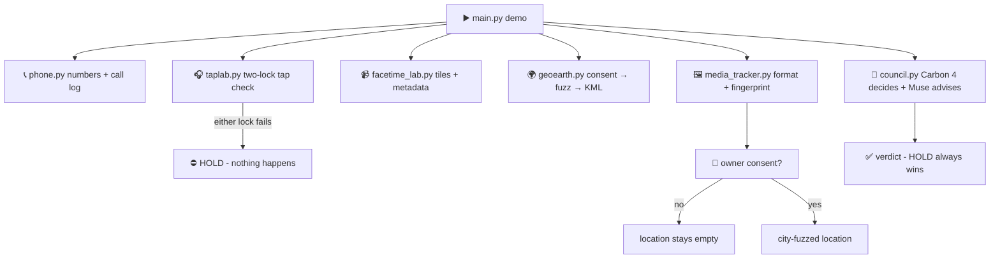

---

## 💻 Tech Stack Badges & Architecture

### 🐍 Core Programming Languages & Core Systems


### 🌐 Web3 & Infrastructure

*None — honestly. TapBaitx has no blockchain, no wallet, and no network service. It is an offline lab.*

### 🖥️ Platform Support & Hardware Architecture


### ⚡ Low-Level Infrastructure & Performance


### 🔧 DevOps & Build Tools


### ☁️ Cloud Providers

*None required. Optional, names-only, never called by default: `GEMINI_API_KEY` (Carbon 4 seat), `MODEL_API_KEY` (Muse seat), `GOOGLE_MAPS_API_KEY` (live Earth/Maps seat — HOLD-gated).*

### 🔄 Updated Workflows

| Workflow | File | What it runs |
|---|---|---|
| ✅ CI | `.github/workflows/ci.yml` | Python pytest + `main.py` checks, Node JS checks, Java compile + checks |
| 🐳 Docker Publish | `.github/workflows/docker-publish.yml` | Builds and pushes `credkellar/tapbaitx:latest` using the `DOCKERHUB_USERNAME` + `DOCKERHUB_TOKEN` repo secrets |

---

## 😎 Why is this cool?

Because it teaches real phone, location, and media technology the safe way — with the locks visible, not hidden.

## 🔟 10 reasons why this is cool

1. 📞 You learn how phone numbers and call logs really work, on fake numbers that can never embarrass a real person.
2. 🎧 The wire-tap chamber teaches the *lawful* shape of a tap — authorization first, target second, record everything — by making anything else impossible in the code.
3. 📹 The FaceTime-style lab shows the kindest rule in video calling: nobody is seen until *they* turn their own camera on.
4. 🌍 Location is **off by default**, and even when it is on, public output is city-fuzzed — you can share "Los Angeles" without sharing your house.
5. 🖼️ The media tracker catches a copied photo or GIF instantly, because copies have the same SHA-256 fingerprint.
6. 🎞️ GIF frame counting and video motion work on **real bytes and real math**, not pictures of results.
7. 🧠 It has a two-brain council — Carbon 4 decides, Muse advises — and the advisor *cannot* overrule a safety HOLD.
8. 🐍☕🟨 The same ideas are written in **Python, Java, and JavaScript**, so it doubles as a language-learning project.
9. 🧪 Everything is proven: **pytest 6 passed, Python CHECKS 24/24, JS CHECKS 7/7** — run them yourself.
10. 🔒 There is not one secret, password, or real person's data anywhere in the project. It is safe to share with anyone.

---

## 🧩 What problems this solves?

| # | 😖 Problem | ✅ Solution |
|---|---|---|
| 1 | Learning about taps can slide into spying on real people | **Solution 1:** synthetic fixture lines only — a real line raises HOLD before anything runs |
| 2 | "Authorized" tools often skip the paperwork | **Solution 2:** no authorization reference = no session, enforced in code, not in a promise |
| 3 | Location sharing leaks your exact home address | **Solution 3:** consent-first + city fuzzing *before* export — exact coordinates never enter a public file |
| 4 | People get tracked without knowing | **Solution 4:** sharing is OFF by default, the level is chosen by the owner, and tracking another person is a permanent HOLD gate |
| 5 | A photo's hidden GPS data travels with it when shared | **Solution 5:** EXIF location is read only with owner consent, and a strip-metadata plan shows exactly what to remove |
| 6 | The same image/GIF gets saved and shared as "new" copies | **Solution 6:** SHA-256 fingerprints dedupe media — copies are caught by hash, not by eye |
| 7 | Nobody knows how many frames a GIF has or when a video changes scene | **Solution 7:** real GIF frame counting from the byte stream + a video motion/scene-change model |
| 8 | Video-call tools can show people who never agreed to be seen | **Solution 8:** visible = joined **AND** camera on — both, always |
| 9 | Encrypted call traffic tempts people to "just peek" at payloads | **Solution 9:** metadata-only summaries — sizes and timing, payloads never inspected |
| 10 | AI helpers sometimes talk people into unsafe actions | **Solution 10:** tighten-only council — Carbon 4 can raise a HOLD, Muse can only advise, neither can lift a gate |

---

## 📥 How to install this? Step-by-step

1. **Get the code**
   ```bash
   git clone https://github.com/credkellar/TapBaitx.git
   cd TapBaitx
   ```
2. **Run the Python version** (nothing to install — standard library only)
   ```bash
   python3 main.py
   ```
   You should see `CHECKS 24/24`.
3. **Run the Python tests**
   ```bash
   pip install pytest
   python3 -m pytest -q
   ```
   You should see `6 passed`.
4. **Run the JavaScript version**
   ```bash
   node js/tapbaitx.js
   ```
   You should see `JS CHECKS 7/7`.
5. **Run the Java version** (needs a JDK, see Requirements)
   ```bash
   cd java
   javac TapBaitx.java
   java TapBaitx
   ```
   You should see `JAVA CHECKS 6/6`.
6. **(Optional) Run it in Docker**
   ```bash
   docker build -t tapbaitx .
   docker run tapbaitx
   ```
7. **(Optional, GitHub)** Paste the two workflow files into `.github/workflows/` (plural) and add the Docker Hub secrets (`DOCKERHUB_USERNAME`, `DOCKERHUB_TOKEN`) in repo Settings → Secrets → Actions. The first push then runs CI, and Docker Publish pushes `credkellar/tapbaitx:latest`.

---

## 📋 Requirements?

| Thing | Needed for | Notes |
|---|---|---|
| 🐍 Python 3.12+ | Main project + tests | Standard library only; `pytest` is the one test install |
| 🟨 Node.js 24+ | JavaScript port | Zero npm packages |
| ☕ JDK 17+ | Java port | JDK standard library only. ⚠️ The project was built on a machine with **no JDK installed**, so the Java file is source-delivered and its checks run in CI (or on your machine) — the Python and JavaScript versions are the ones verified live at build time |
| 🐳 Docker | Optional container run | Builds from `python:3.12-slim` |
| 🔑 API keys | **Not required** | All seats run offline. Keys, if you ever add them, are environment-variable *names* only — never paste a key value into this repo |

---

## 🧒 Explain in 5th grade English

Imagine you have a toy phone that only calls pretend numbers. 📞

TapBaitx is a practice kit for how real phones, video calls, maps, and pictures work — but everything in the kit is pretend or yours.

- The "wire tap" is like listening to a **play** you wrote, with puppets. You need a hall pass (the authorization) even for the puppets. Listening to a real person's call is **never allowed** — the kit locks that door and throws away the key. 🔒
- The map only shows where **you** say it can, and it draws your dot **big and fuzzy** — like a whole city — so nobody can find your house. 🌍
- Every picture gets a **fingerprint**. If someone copies your picture, the fingerprint matches, and the kit says "hey, that's a copy!" 🖼️
- On video calls, nobody can see you until **you** press the camera button yourself. 📹
- Two robot brains help decide if something is safe. One decides, one gives advice. If either one says "stop," the answer is stop. 🧠

That's it: learn how the real thing works, practice on pretend things, and keep every real person safe.

---

## 📜 Script-by-script — with a mermaid flowchart for each script

### ▶️ `main.py` — demo + 24 CHECKS

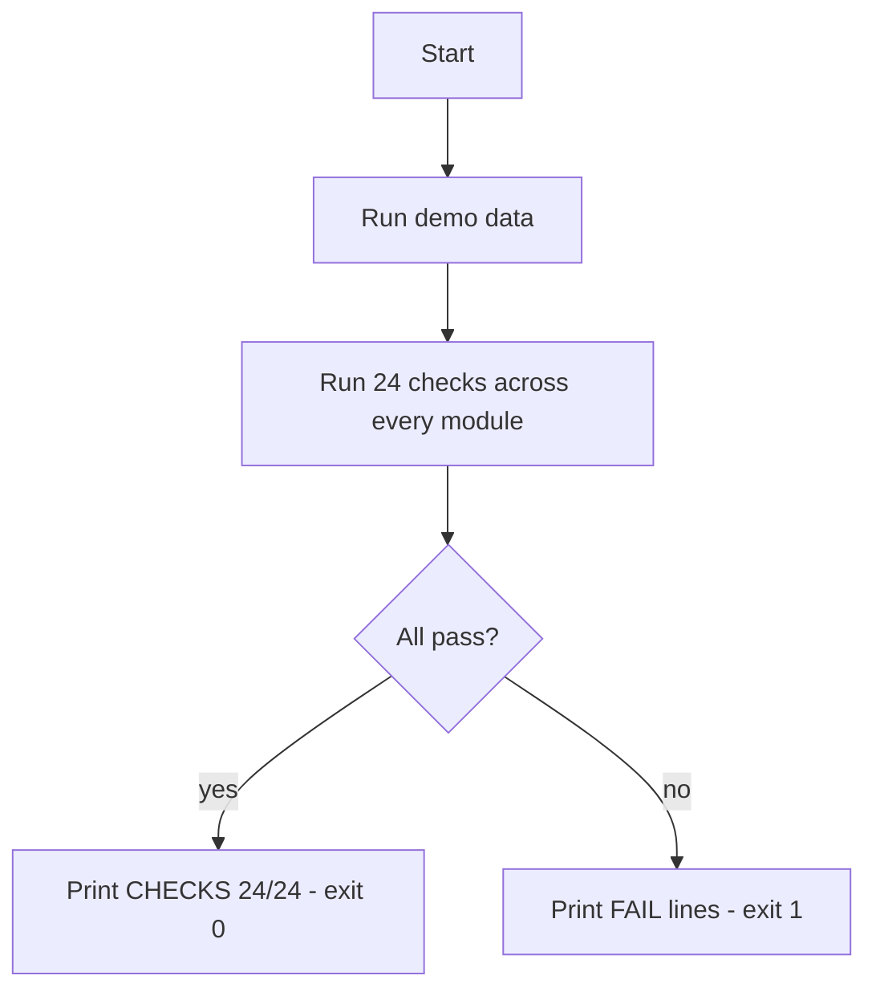

### 🔒 `tapbaitx/gates.py` — the 14 HOLD gates

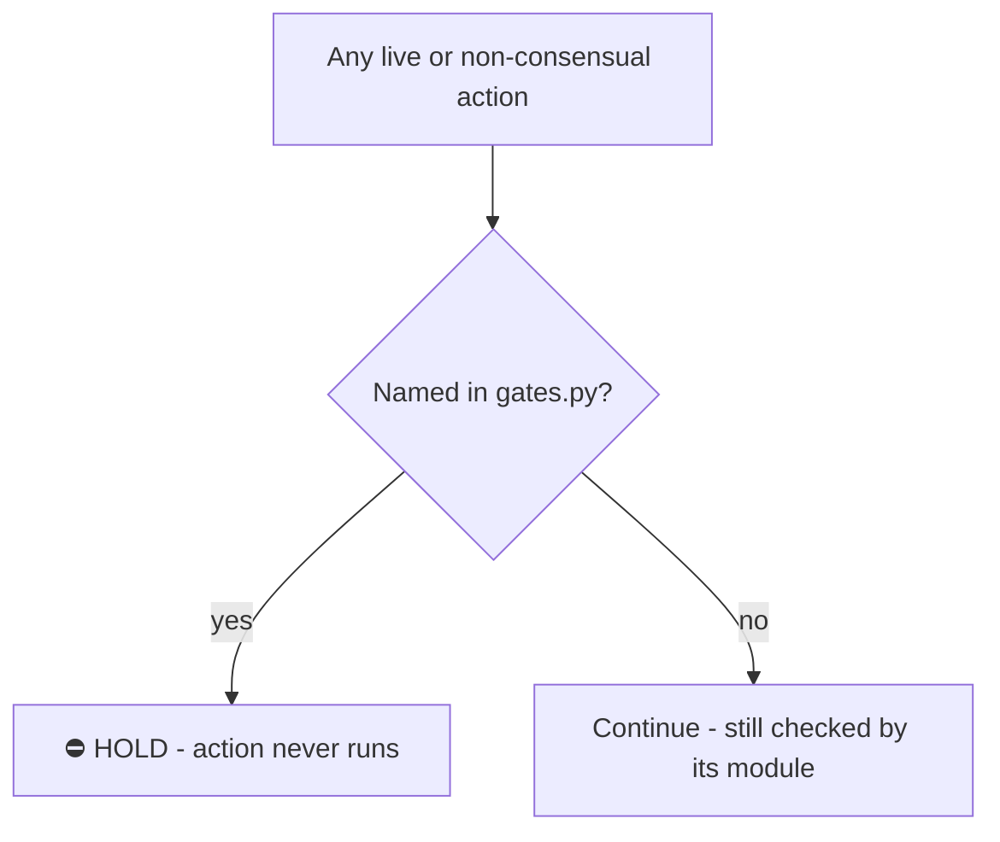

### 📞 `tapbaitx/phone.py` — numbers, cell profiles, call log

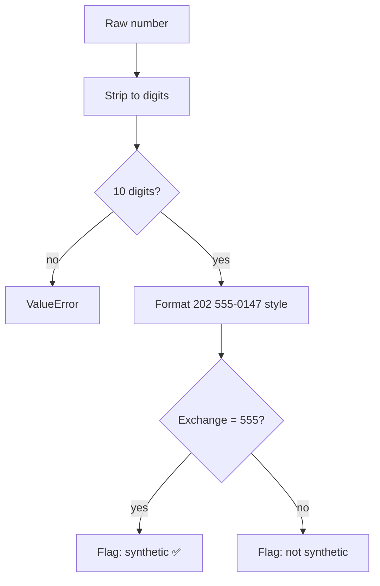

### 🎧 `tapbaitx/taplab.py` — the simulated tap chamber

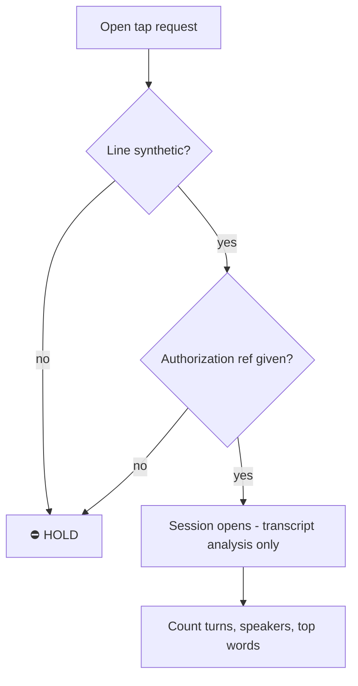

### 📹 `tapbaitx/facetime_lab.py` — FaceTime-style video lab

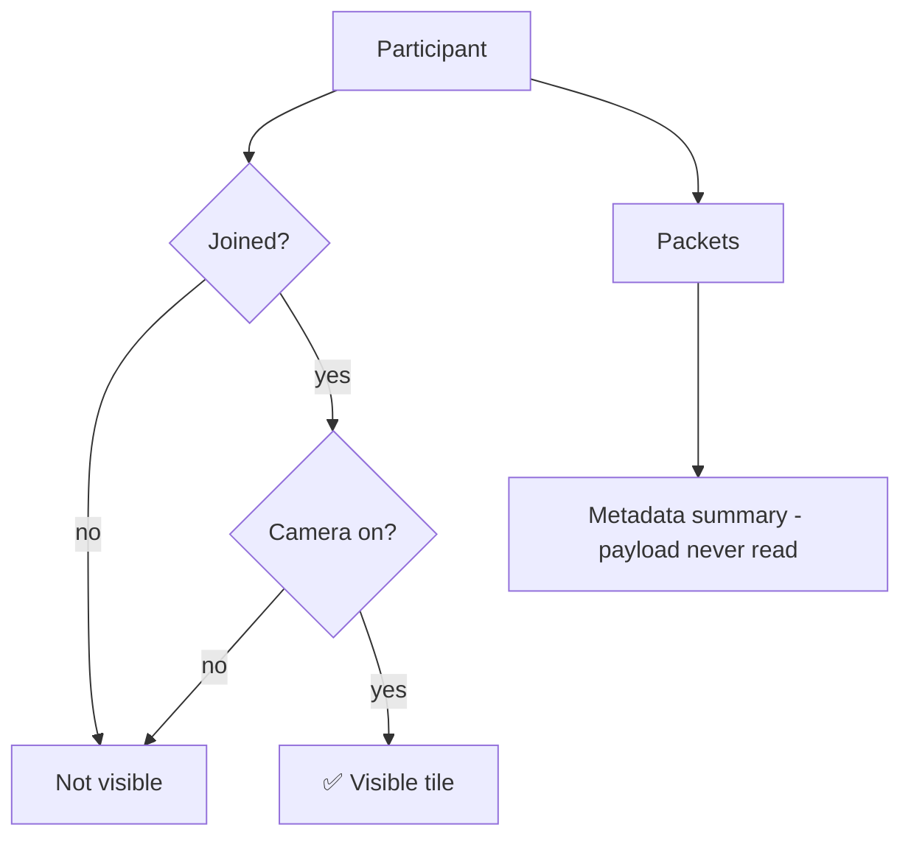

### 🌍 `tapbaitx/geoearth.py` — consent-first Google Earth

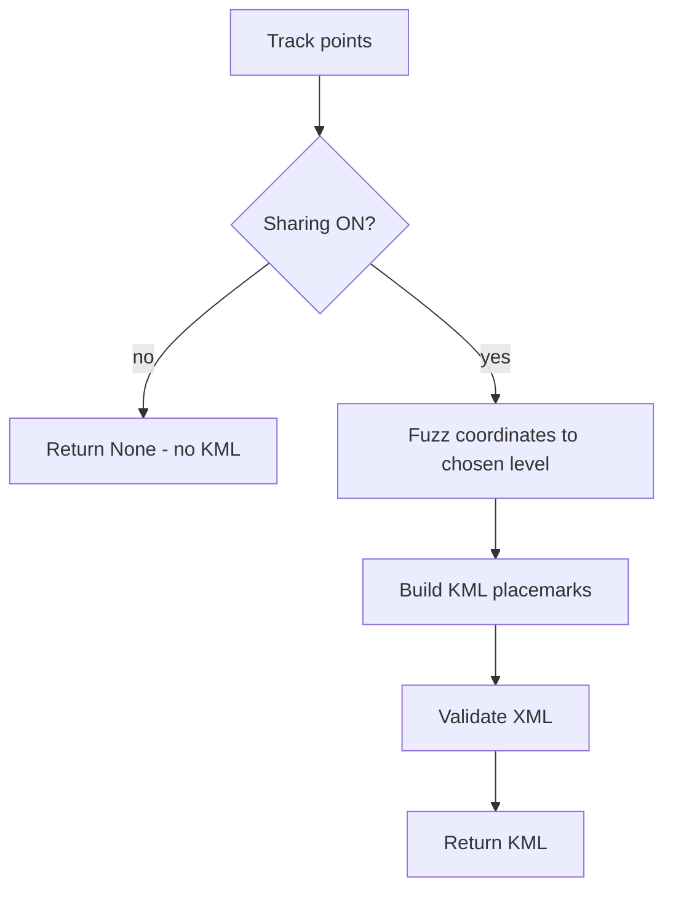

### 🖼️ `tapbaitx/media_tracker.py` — image / GIF / video tracker

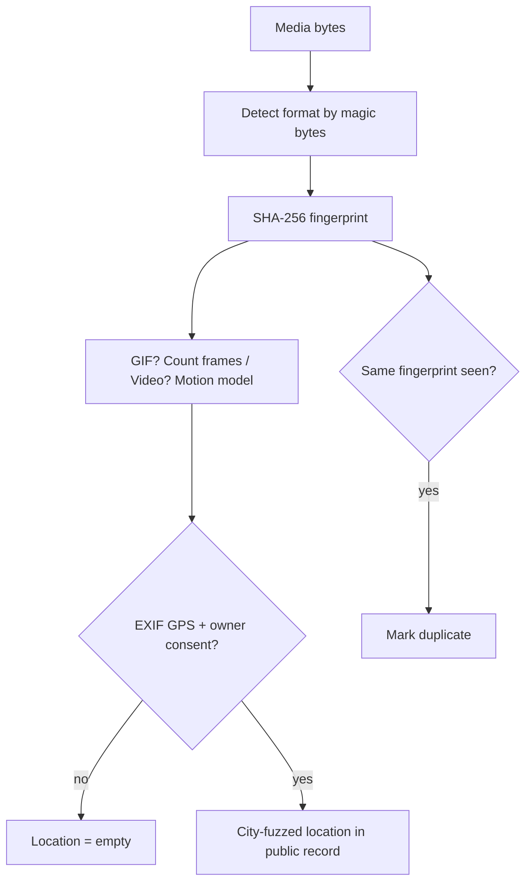

### 🧠 `tapbaitx/council.py` — Carbon 4 + Muse council

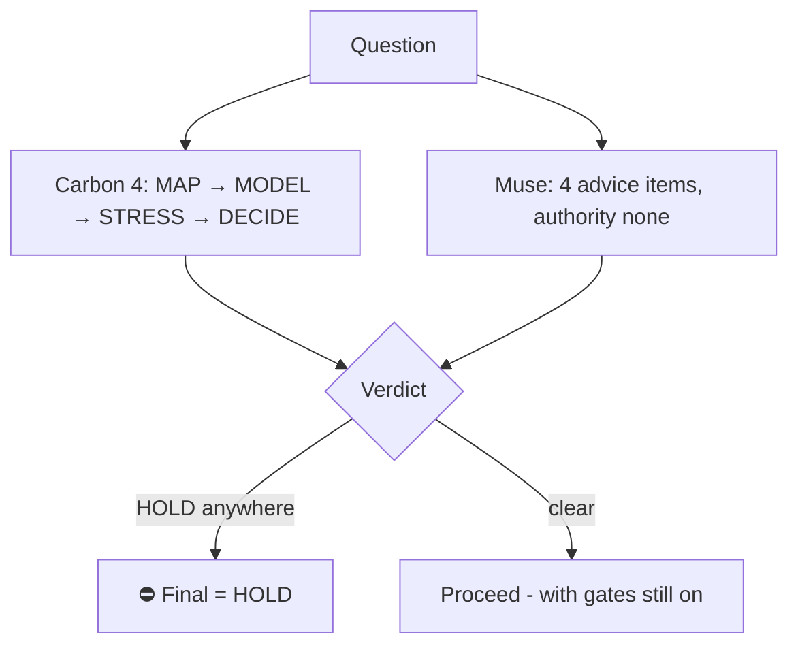

### 🟨 `js/tapbaitx.js` — JavaScript port

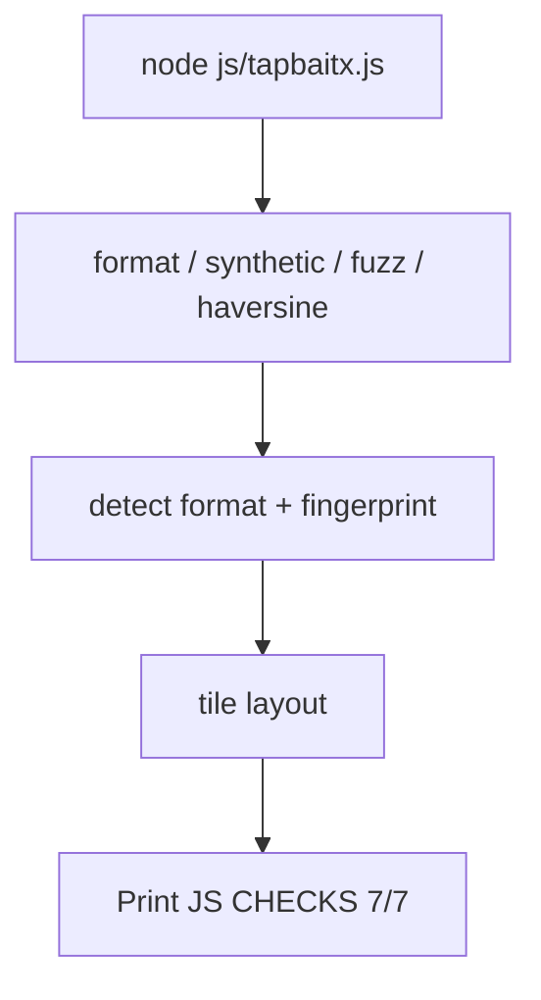

### ☕ `java/TapBaitx.java` — Java port

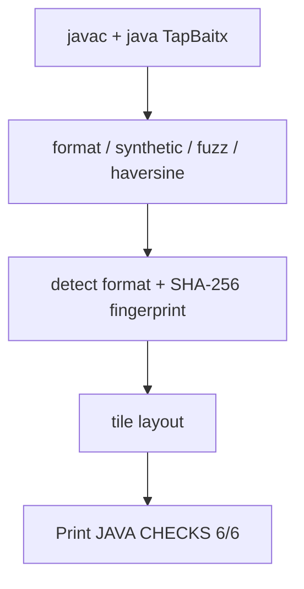

---

## ⛔ The 14 HOLD gates

| Gate | What it locks |
|---|---|
| `live_wiretap_real_line` | Tapping a real phone line |
| `covert_interception` | Spying on another person, in secret, ever |
| `facetime_interception_decryption` | Decrypting or tapping real FaceTime traffic |
| `tracking_another_person` | Tracking another person's location |
| `carrier_network_access` | Carrier / SS7 / Diameter network access |
| `imsi_catcher` | IMSI catcher / stingray operation |
| `call_recording_without_consent` | Recording a real call without consent notice |
| `live_location_api_call` | Live Earth/Maps calls without key + consent |
| `live_gemini_api_call` | Live Carbon 4 calls (seat runs offline) |
| `live_muse_api_call` | Live Muse calls (seat runs offline) |
| `media_upload_external` | Uploading tracked media to an outside service |
| `exact_location_public_share` | Exact coordinates in public output |
| `child_location_sharing` | Sharing a child's location |
| `exif_location_of_others_media` | Reading location from another person's media without consent |

---

## 🌳 Project structure

```
TapBaitx/
├── 📄 README.md
├── ▶️ main.py
├── 🐳 Dockerfile
├── 📦 tapbaitx/
│   ├── __init__.py
│   ├── 🔒 gates.py
│   ├── 📞 phone.py
│   ├── 🎧 taplab.py
│   ├── 📹 facetime_lab.py
│   ├── 🌍 geoearth.py
│   ├── 🖼️ media_tracker.py
│   └── 🧠 council.py
├── 🟨 js/
│   └── tapbaitx.js
├── ☕ java/
│   └── TapBaitx.java
├── 🧪 tests/
│   └── test_all.py
└── 🔄 .github/workflows/
    ├── ci.yml
    └── docker-publish.yml
```

---

## ✅ Verification (run at build time, re-runnable any time)

```
python3 main.py        → CHECKS 24/24
python3 -m pytest -q   → 6 passed        (clean copy, fresh venv)
node js/tapbaitx.js    → JS CHECKS 7/7
java/TapBaitx.java     → source-delivered (no JDK on the build machine; CI compiles + runs it)
```

---

## ⚖️ Honest scope

- ✅ **Real:** number formatting/validation, synthetic-log determinism, haversine math, coordinate fuzzing, KML generation + XML validation, magic-byte format detection, SHA-256 fingerprints, GIF frame counting, tile-layout math, the two-lock tap gate, the consent gates.
- 🎭 **Modelled / simulated:** the tap chamber (synthetic transcripts, no audio), FaceTime-style rooms (no call is ever connected), cell profiles (published-style figures, not measurements), video motion (from brightness data you supply).
- ⛔ **Never in this project:** a real tap, a real track of another person, real FaceTime decryption, carrier access, or a live API call. Those doors are HOLD gates, and the council cannot open them.
